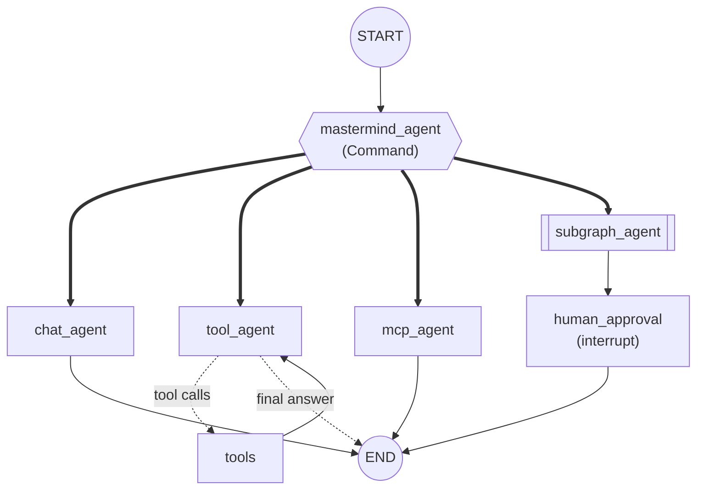

# template_multiagent_system

A deliberately small **multi-agent template built on [LangGraph](https://langchain-ai.github.io/langgraph/)**.
The use cases have **no business logic** (add numbers, reverse text, split a request into subtasks): they exist only to
show the building blocks of a multi-agent system. Replace them with your own.

**How to read it:** run the demo, then read `src/graphs/main_graph.py` top to bottom (it is the map of the system).

## Quick start

Requirements: Python 3.11+, [uv](https://docs.astral.sh/uv/) and a [Groq](https://console.groq.com) API key (the tests need none).

```powershell
uv sync                          # create .venv and install dependencies
copy .env.example .env           # then edit .env and set GROQ_API_KEY
uv run python main.py            # run the demo (one request per agent)
uv run python main.py "What is 2 + 3?"                  # your own request
uv run pytest                    # offline tests, no API key needed
```

Models are set in `agents_config.yaml` (change the `model` fields if your Groq account has no access to them).

## What the demo shows

A **mastermind** (router) reads the request and sends it to one agent. Each agent shows one concept:

| Agent | Concept |
|---|---|
| `chat_agent` | The simplest agent: one LLM call. |
| `tool_agent` | **Tool calling**: the LLM asks for local Python tools, a `ToolNode` runs them, the loop repeats. |
| `mcp_agent` | **MCP**: the tool lives in another process (`src/mcp_servers/demo_server.py`). |
| `subgraph_agent` | A **subgraph** with its own state: planner, parallel workers (`Send`), assemble. Then the graph pauses for **human approval**. |



Inside `subgraph_agent`: `START -> planner_agent --Send x N--> worker (parallel) -> assemble -> END`.

Arrows: `-->` normal edge, `-.->` conditional edge, `==>` the node chooses (`Command` / `Send`).

## Project structure

```text
main.py                       # CLI demo: streams node events, handles the approval pause
agents_config.yaml            # per-agent LLM config (model, temperature, API-key variable, output model)
src/
├── config.py                 # get_llm(): the one place where a chat model is created
├── core/
│   ├── base_agent.py         # BaseAgent: config, prompt, LLM, structured_invoke, ask()
│   └── agent_registry.py     # which agents exist, by domain (lets the router discover them)
├── agents/                   # one class per agent; `ask(state)` is the LangGraph node function
├── graphs/
│   ├── main_graph.py         # THE MAP: nodes, edges, checkpointer. Start here.
│   └── subgraph.py           # the subgraph
├── mcp_servers/demo_server.py
├── tools/demo_tools.py       # local LangChain tools
├── pydantic_models/
│   ├── graph_states/         # MainState and SubgraphState (the two states)
│   └── agents/               # structured-output models (router decision, plan)
└── system_prompts/           # <agent_name>.py exposing PROMPT
tests/                        # offline tests (LLM stubbed)
```

Agents hold behaviour, graphs hold wiring, pydantic_models hold data contracts, system_prompts hold prompts, tools hold
capabilities. Because wiring is separate from behaviour, an agent can be tested without building a graph.

## LangGraph feature map

| Feature | Where |
|---|---|
| State as a Pydantic model + reducer `add_messages` | `graph_states/main_state.py` |
| Reducer `operator.add` (fan-in of parallel workers) | `graph_states/subgraph_state.py` |
| A second, independent state (subgraph) and the adapter between both | `agents/subgraph_agent.py` |
| Normal and conditional edges (`tools_condition`) | `graphs/main_graph.py` |
| `Command` (update state + choose next node) | `agents/mastermind_agent.py` |
| `Send` (parallel map-reduce), private `input_schema` | `graphs/subgraph.py` |
| Cycle (tool loop) | `graphs/main_graph.py` |
| Tool calling (`bind_tools`, `ToolNode`) | `agents/tool_agent.py`, `tools/demo_tools.py` |
| MCP client and server, prebuilt `create_agent` | `agents/mcp_agent.py`, `mcp_servers/demo_server.py` |
| `RetryPolicy` | `graphs/main_graph.py` (on the MCP node) |
| Human-in-the-loop (`interrupt`) + checkpointer | `graphs/main_graph.py`, `main.py` |
| Structured output | `core/base_agent.py` (`structured_invoke`) |
| Dependency injection for tests | `build_main_graph(overrides=...)` |

## Key design ideas

- **An agent is a class; a node is `agent.ask`.** `BaseAgent` gives every agent the same shape: identity (`name`,
  `description`, `domain`), config from `agents_config.yaml`, a prompt from `src/system_prompts/<name>.py`, and `ask(state)`.
  A node returns **only the keys it changes**; LangGraph merges them using each key's reducer.
- **Config in YAML, secrets in `.env`.** `api_key_env` holds the *name* of the variable, never the key. The key under
  `agents:` must equal the agent's `name`, or the agent silently uses the defaults.
- **The registry lets the router discover agents.** `@AgentRegistry.register` tags each agent with a `domain`; the
  mastermind builds its prompt from `describe_all("mastermind")`. Registration happens on import, so every agent module
  must be listed in `src/agents/__init__.py`.
- **Human-in-the-loop needs a checkpointer.** `interrupt()` saves the state and stops; the caller resumes with
  `Command(resume=...)` and the same `thread_id`. On resume the node re-runs from its first line, so keep code before
  `interrupt()` free of side effects.

## Recipe: add a new agent

1. **Class** in `src/agents/my_agent.py`, decorated with `@AgentRegistry.register`, with `name`, `domain = ["mastermind"]`,
   `description` (the router reads it) and `ask(self, state) -> dict`. Copy `chat_agent.py`.
2. **Import** it in `src/agents/__init__.py`.
3. **Prompt**: `src/system_prompts/my_agent.py` with `PROMPT = """..."""`.
4. **Config**: a `my_agent:` block in `agents_config.yaml` (`{}` takes the defaults).
5. **Wire it** in `main_graph.py`: `add_node`, an edge to `END`, its name in `ROUTE_TARGETS` and in the `Literal` of
   `pydantic_models/agents/mastermind_agent.py` (`tests/test_registry.py` fails if they disagree).
6. **Test** it with a stubbed LLM (see `tests/test_main_graph.py`).

To remove a demo agent, undo those steps.

## Testing

`uv run pytest` runs offline: real agent and graph classes, only the LLM call is replaced (`structured_invoke` by a lambda,
`llm` by `ScriptedLLM` in `tests/fakes.py`, and `build_main_graph(overrides=...)` injects the prepared agents).

## Gotchas

- With no `output_schema`-style filtering, read optional keys with `result.get("route")`: keys no node wrote may be absent.
- **Async propagates.** The MCP client is async, so run the graph with `ainvoke` / `astream`.
- **Avoid circular imports between agents and graphs.** `subgraph_agent` imports `subgraph`, which needs the agent classes, so
  `build_subgraph` imports them inside the function.
- Use `method="json_schema"` for structured output (done in `structured_invoke`); put rules like min/max items in Pydantic
  validators, not in `Field` constraints.
- On Windows PowerShell 5.1, `Set-Content -Encoding utf8` writes a BOM that breaks `pyproject.toml`. Use your editor.

## Not covered (natural next steps)

Long-term memory (`Store`), persistent checkpointers, time travel, token streaming, guardrails, other LLM providers and
remote MCP servers over HTTP.
