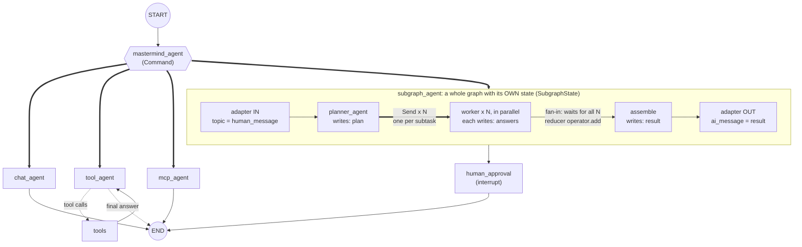

# backend

The **multi-agent system**: a deliberately small template built on [LangGraph](https://langchain-ai.github.io/langgraph/),
served through a FastAPI API. The use cases have **no business logic** (add numbers, reverse text, split a request into
subtasks): they exist only to show the building blocks of a multi-agent system. Replace them with your own.

This folder is **self-contained**: its own `pyproject.toml`, `uv.lock`, `.venv` and `.env`. It knows nothing about the
frontend; the only thing they share is the HTTP contract below. Run every command of this README from `backend/`.

**How to read it:** run the demo, then read `src/graphs/main_graph.py` top to bottom (it is the map of the system).

## Quick start

Requirements: Python 3.11+, [uv](https://docs.astral.sh/uv/) and a [Groq](https://console.groq.com) API key (the tests need none).

```powershell
cd backend
uv sync                          # create .venv and install dependencies
copy .env.example .env           # then edit .env and set GROQ_API_KEY
uv run python main.py            # start the API (http://127.0.0.1:8000, interactive docs at /docs)
uv run python cli.py --chat      # or talk to the system from the terminal, no server needed
uv run pytest                    # offline tests, no API key needed
```

Models are set in `agents_config.yaml` (change the `model` fields if your Groq account has no access to them).

## The API

`main.py` is the **entry point of the application**: it starts a FastAPI server (`src/api/app.py`). `HOST` and `PORT`
(environment variables) change where it listens (default `127.0.0.1:8000`).

| Endpoint | Body | Returns |
|---|---|---|
| `POST /chat` | `{"message": "Reverse the text 'langgraph'"}` | `{"thread_id", "status", "route", "answer", "question", "preview", "trace"}` |
| `POST /approve` | `{"thread_id": "...", "approved": true}` | the same shape, once the run has resumed |
| `GET /health` | | `{"status": "ok"}` |

`status` is `completed` (read `answer`) or `needs_approval` (the graph is paused; read `question` and `preview`, then call
`/approve` with the same `thread_id`). `/approve` answers `404` for an unknown `thread_id` and `409` if that run is not
waiting for approval. If the graph itself fails (for example the LLM provider is down) the API answers `502` with the
reason in `detail`, instead of a bare `500`.

### The trace: how the state evolves

Every response carries a `trace`: the steps the graph executed **during that call**, in order, including the steps of
subgraphs. This is the traceability view the frontend draws under each answer.

```json
{"index": 2, "graph": "main", "node": "mastermind_agent",
 "update": {"route": "chat_agent"},
 "state":  {"human_message": "hi", "route": "chat_agent", "messages": []}}
```

| Field | Meaning |
|---|---|
| `index` | Position in the run (1, 2, 3...). |
| `graph` | `main`, or the agent that owns the subgraph (`subgraph_agent`). Steps of different graphs interleave in order. |
| `node` | The node that ran. `(start)` is the state of a graph before any node ran; `__interrupt__` is the pause for human approval. |
| `update` | **Exactly what the node returned**: only the keys it changed. |
| `state` | The **full state of that graph right after the step**, with every reducer already applied. |

`update` against `state` is the whole lesson about state: a node writes a few keys; the graph merges them. Subgraph steps show
`SubgraphState` (`topic`, `plan`, `answers`, `result`), never `MainState`, which is the two-states design made visible. For an
approval flow, `/chat` returns the trace up to the pause and `/approve` returns the trace of the resumed part.

It is built in `src/api/trace.py` with `graph.astream(..., stream_mode=["updates", "values"], subgraphs=True)`: `updates` gives what a
node returned, `values` gives the full state, and each update is paired with the snapshot that follows it. The trace comes back
when the call finishes; it is not streamed live.

```powershell
curl -X POST http://127.0.0.1:8000/chat -H "Content-Type: application/json" `
     -d '{\"message\": \"Reverse the text langgraph\"}'
```

How the pieces fit: the graph is built once when the server starts (`create_app` in `src/api/app.py`). Its checkpointer lives in
the server's memory, which is what lets `/approve` resume the run that `/chat` started. Consequences: a server restart forgets
paused runs, and every `/chat` is an independent run with no memory of earlier messages (see "Not covered").

## Talk to the mastermind from the terminal

The entry point is always the **mastermind**: you never choose an agent, you just write a request and it decides
who handles it. `cli.py` offers three ways to do that in the terminal:

| Command | What it does |
|---|---|
| `uv run python cli.py --chat` | **Interactive.** Type a request, read the answer, type another. An empty line exits. |
| `uv run python cli.py "Reverse the text 'langgraph'"` | Sends one request and exits. |
| `uv run python cli.py` | Runs the demo: one request per agent. |

Add `--auto-approve` to skip the human-approval question (see below).

A real session (`--chat`). While the graph runs you see each node that executes (`->`); nodes inside a subgraph or a
prebuilt agent are indented with the agent that owns them:

```text
You (empty line to exit): Reverse the text 'langgraph'
======================================================================
USER: Reverse the text 'langgraph'
======================================================================
-> mastermind_agent                     <- the router picked an agent...
  -> model   (inside mcp_agent)         <- ...which asked its LLM,
  -> tools   (inside mcp_agent)         <- ...called the MCP tool,
  -> model   (inside mcp_agent)         <- ...and wrote the answer
-> mcp_agent

ROUTE : mcp_agent                       <- who handled it (state.route)

ASSISTANT:
The reversed text is: hparggnal.
```

What to type to reach each agent (the mastermind reads the agents' `description`, so natural phrasing works):

| You write | Routed to | What you will see |
|---|---|---|
| `Hi! What can you do?` | `chat_agent` | A short free-text answer. |
| `What is 1250 + 4750? And what time is it?` | `tool_agent` | `tool_agent -> tools -> tool_agent` loop. |
| `Reverse the text 'langgraph'` | `mcp_agent` | The tool call goes to the MCP server process. |
| `Answer in parallel: what is a cat, a dog and a bird?` | `subgraph_agent` | Planner, 3 parallel workers, assemble, then the **pause**. |

**The pause.** After `subgraph_agent` the graph stops at `human_approval` and prints `[PAUSED] Do you approve this answer?`
with a preview. Answer `yes` to deliver it; anything else rejects it. The run can resume because the state was saved by
the checkpointer under the request's `thread_id`.

**Limits to keep in mind.** Each line you type is an independent request (a new `thread_id`), so the system does not
remember earlier turns. If you want a conversation, reuse the same `thread_id` and keep `messages` in the state
(see "Not covered"). To talk to the graph from your own code instead of the CLI:

```python
import asyncio
from src.graphs.main_graph import build_main_graph

graph = build_main_graph()
config = {"configurable": {"thread_id": "my-conversation"}}
result = asyncio.run(graph.ainvoke({"human_message": "Reverse the text 'langgraph'"}, config))
print(result["route"], result["ai_message"])
```

## What the demo shows

A **mastermind** (router) reads the request and sends it to one agent. Each agent shows one concept:

| Agent | Concept |
|---|---|
| `chat_agent` | The simplest agent: one LLM call. |
| `tool_agent` | **Tool calling**: the LLM asks for local Python tools, a `ToolNode` runs them, the loop repeats. |
| `mcp_agent` | **MCP**: the tool lives in another process (`src/mcp_servers/demo_server.py`). |
| `subgraph_agent` | A **subgraph** with its own state: planner, parallel workers (`Send`), assemble. Then the graph pauses for **human approval**. |



Arrows: `-->` normal edge, `-.->` conditional edge, `==>` the node chooses (`Command` / `Send`).
The big box is **one node** of the main graph (`subgraph_agent`); everything inside it is a separate graph with its own
state. The next section explains it step by step.

## The subgraph in detail

A **subgraph** is a complete graph used as a single step of another graph. Here `subgraph_agent` receives the user request,
splits it into subtasks, solves them **in parallel** and merges the answers. It is the only place in the repo with a second
state, parallel fan-out (`Send`) and a reducer that merges parallel writes.

### Two states that never mix

| | `MainState` (main graph) | `SubgraphState` (subgraph) |
|---|---|---|
| File | `graph_states/main_state.py` | `graph_states/subgraph_state.py` |
| Keys | `human_message`, `route`, `messages`, `approval`, `ai_message` | `topic`, `plan`, `answers`, `result` |

They share **no keys**, so the subgraph cannot read or overwrite anything of the main graph by accident. Because the schemas
differ, the compiled subgraph cannot be added as a node directly: `SubgraphAgent.ask` is the **adapter** that translates:

```text
MainState.human_message --(IN)--> SubgraphState.topic
   ... the subgraph runs and fills plan, answers, result ...
SubgraphState.result    --(OUT)-> MainState.ai_message      (the only key written back)
```

### Why two states and two graphs (and not one big graph)

Nothing forces this design. You could make `planner_agent`, `worker` and `assemble` plain nodes of the main graph and add
`topic`, `plan`, `answers` and `result` to `MainState`. It would run. This is what that would look like, and what we avoid:

```python
class MainState(BaseModel):                       # flattened: NOT how this repo does it
    human_message: str
    route: str | None = None
    messages: Annotated[list[AnyMessage], add_messages] = []
    approval: Literal["approved", "rejected"] | None = None
    ai_message: str | None = None
    topic: str | None = None                      # <- only the subgraph needs these four
    plan: Plan | None = None
    answers: Annotated[list[str], operator.add] = []   # <- and this reducer now applies to the WHOLE graph
    result: str | None = None
```

| Reason | If everything lived in one state and one graph | In this repo |
|---|---|---|
| **The main state stays a small contract** | Every agent (`chat_agent`, `tool_agent`...) carries the subgraph's scratch data. It shows up in every checkpoint and in `aget_state`. | `MainState` has 5 keys. `plan` and `answers` never appear in it (`test_2_a`, `test_2_d`). |
| **No key collisions** | Reducers belong to a key and apply to the whole graph. Generic names like `result` or `plan` collide as soon as a second feature needs them, and a node that wanted to *overwrite* `answers` would silently *append*. | Each graph owns its keys. A second subgraph can have its own `result` without conflict. |
| **Intermediate data has a lifecycle** | The N workers' partial answers stay in the main state until the run ends. | They live and die inside the subgraph. Only the final text crosses back. |
| **The inner graph is runnable and testable alone** | To test the fan-out you have to build the mastermind, the checkpointer and the `interrupt`. | `build_subgraph()` compiles by itself; `tests/test_subgraph.py` runs it with no main graph at all. |
| **The main graph stays readable** | `main_graph.py` fills up with the planner, N workers, the fan-in, the retry policy... | The main graph shows **one node**, `subgraph_agent`. `Send`, the fan-in and the `RetryPolicy` on the planner are internal details. |
| **Internals can change freely** | Adding a reviewer loop or more workers means editing the main graph and maybe its state. | Change the subgraph as you like; as long as the adapter contract holds (`topic` in, `result` out), `main_graph.py` does not change. |
| **Reuse and ownership** | The nodes are welded to the main graph's state. | The same subgraph can serve another parent graph with a different adapter, or be owned by another team. |

**What it costs.** You write and maintain the adapter (`SubgraphAgent.ask`), and data crosses the border only if you map it
explicitly: if the main graph or the UI also needed the `plan`, you would have to copy it out on purpose. That friction is the
point (nothing leaks by accident), but it is not free.

**When not to do it.** If parent and child naturally work on the *same* data (typically both read and write `messages`), a subgraph
with **shared keys** is simpler: no adapter, just `builder.add_node("name", compiled_subgraph)`. Rule of thumb: separate states when
the subgraph has its own private working data (like `plan` and `answers` here); share keys when it is just a way to group
nodes that operate on the same state.

### What happens, step by step

| Step | Node | Reads | Writes | What happens |
|---|---|---|---|---|
| 0 | adapter IN | `MainState.human_message` | `SubgraphState.topic` | The request enters the subgraph. |
| 1 | `planner_agent` | `topic` | `plan` | One LLM call with **structured output**: a `Plan` with 2-3 `subtasks`. |
| 2 | `fan_out` (the edge) | `plan` | nothing | A conditional edge returns one `Send("worker", SubtaskInput(subtask=...))` per subtask. |
| 3 | `worker` x N | its own `SubtaskInput` | `answers` | The N workers run **in the same step, in parallel**. Each sees only its subtask. |
| 4 | `assemble` | `answers` | `result` | Plain function. Starts only when **all** workers are done (fan-in). |
| 5 | adapter OUT | `result` | `MainState.ai_message` | The answer leaves the subgraph. Then `human_approval` pauses the main graph. |

Three details worth remembering:

- **`Send` carries a private payload.** The worker's input schema is `SubtaskInput` (just `subtask`), not `SubgraphState`.
  The worker does not see `topic`, `plan` or the other workers' answers.
- **`answers` needs a reducer.** The N workers write `answers` in the same step. Without `operator.add` LangGraph raises
  `InvalidUpdateError`; with it the N one-item lists are concatenated.
- **The number of workers is decided at runtime** by the LLM (the length of `plan.subtasks`), not by the graph wiring.
  That is what `Send` is for.

### See it running

```text
-> mastermind_agent
  -> planner_agent   (inside subgraph_agent)
  -> worker          (inside subgraph_agent)      <- three workers, same step
  -> worker          (inside subgraph_agent)
  -> worker          (inside subgraph_agent)
  -> assemble        (inside subgraph_agent)
-> subgraph_agent                                  <- back in the main graph: only ai_message was written
[PAUSED] Do you approve this answer? (yes / no)
```

To watch the subgraph state change step by step, run the didactic tests with their printouts:

```powershell
uv run pytest tests/test_state_flow.py -s -k "test_2"
```

`test_2_b` prints the whole `SubgraphState` after every step, `test_2_c` shows what each worker receives and `test_2_d` shows the
adapter mapping in and out. If parent and subgraph shared keys you could skip the adapter and write
`builder.add_node("name", compiled_subgraph)`; the separate-state version is shown here because it is the general case.

## Project structure

```text
backend/
├── main.py                   # entry point: starts the FastAPI server
├── cli.py                    # terminal client: streams node events, handles the approval pause
├── agents_config.yaml        # per-agent LLM config (model, temperature, API-key variable, output model)
├── pyproject.toml, uv.lock   # backend dependencies only
├── .env.example              # copy to .env and set GROQ_API_KEY
├── src/
│   ├── api/                  # FastAPI: app.py (POST /chat, POST /approve) and schemas.py
│   ├── config.py             # get_llm(): the one place where a chat model is created
│   ├── core/
│   │   ├── base_agent.py     # BaseAgent: config, prompt, LLM, structured_invoke, ask()
│   │   └── agent_registry.py # which agents exist, by domain (lets the router discover them)
│   ├── agents/               # one class per agent; `ask(state)` is the LangGraph node function
│   ├── graphs/
│   │   ├── main_graph.py     # THE MAP: nodes, edges, checkpointer. Start here.
│   │   └── subgraph.py       # the subgraph
│   ├── mcp_servers/demo_server.py
│   ├── tools/demo_tools.py   # local LangChain tools
│   ├── pydantic_models/
│   │   ├── graph_states/     # MainState and SubgraphState (the two states)
│   │   └── agents/           # structured-output models (router decision, plan)
│   └── system_prompts/       # <agent_name>.py exposing PROMPT
└── tests/                    # offline tests (LLM stubbed)
```

Agents hold behaviour, graphs hold wiring, pydantic_models hold data contracts, system_prompts hold prompts, tools hold
capabilities. Because wiring is separate from behaviour, an agent can be tested without building a graph.

## LangGraph feature map

| Feature | Where |
|---|---|
| State as a Pydantic model + reducer `add_messages` | `graph_states/main_state.py` |
| Reducer `operator.add` (fan-in of parallel workers) | `graph_states/subgraph_state.py` |
| A second, independent state (subgraph) and the adapter between both | `agents/subgraph_agent.py` |
| Normal and conditional edges (`tools_condition`) | `graphs/main_graph.py` |
| `Command` (update state + choose next node) | `agents/mastermind_agent.py` |
| `Send` (parallel map-reduce), private `input_schema` | `graphs/subgraph.py` |
| Cycle (tool loop) | `graphs/main_graph.py` |
| Tool calling (`bind_tools`, `ToolNode`) | `agents/tool_agent.py`, `tools/demo_tools.py` |
| MCP client and server, prebuilt `create_agent` | `agents/mcp_agent.py`, `mcp_servers/demo_server.py` |
| `RetryPolicy` | `graphs/main_graph.py` (on the MCP node) |
| Human-in-the-loop (`interrupt`) + checkpointer | `graphs/main_graph.py`, `api/app.py`, `cli.py` |
| Structured output | `core/base_agent.py` (`structured_invoke`) |
| Dependency injection for tests | `build_main_graph(overrides=...)` |

## Key design ideas

- **An agent is a class; a node is `agent.ask`.** `BaseAgent` gives every agent the same shape: identity (`name`,
  `description`, `domain`), config from `agents_config.yaml`, a prompt from `src/system_prompts/<name>.py`, and `ask(state)`.
  A node returns **only the keys it changes**; LangGraph merges them using each key's reducer.
- **Config in YAML, secrets in `.env`.** `api_key_env` holds the *name* of the variable, never the key. The key under
  `agents:` must equal the agent's `name`, or the agent silently uses the defaults.
- **The registry lets the router discover agents.** `@AgentRegistry.register` tags each agent with a `domain`; the
  mastermind builds its prompt from `describe_all("mastermind")`. Registration happens on import, so every agent module
  must be listed in `src/agents/__init__.py`.
- **Human-in-the-loop needs a checkpointer.** `interrupt()` saves the state and stops; the caller resumes with
  `Command(resume=...)` and the same `thread_id`. On resume the node re-runs from its first line, so keep code before
  `interrupt()` free of side effects.

## Recipe: add a new agent

1. **Class** in `src/agents/my_agent.py`, decorated with `@AgentRegistry.register`, with `name`, `domain = ["mastermind"]`,
   `description` (the router reads it) and `ask(self, state) -> dict`. Copy `chat_agent.py`.
2. **Import** it in `src/agents/__init__.py`.
3. **Prompt**: `src/system_prompts/my_agent.py` with `PROMPT = """..."""`.
4. **Config**: a `my_agent:` block in `agents_config.yaml` (`{}` takes the defaults).
5. **Wire it** in `main_graph.py`: `add_node`, an edge to `END`, its name in `ROUTE_TARGETS` and in the `Literal` of
   `pydantic_models/agents/mastermind_agent.py` (`tests/test_registry.py` fails if they disagree).
6. **Test** it with a stubbed LLM (see `tests/test_main_graph.py`).

To remove a demo agent, undo those steps.

## Testing

`uv run pytest` runs offline: real agent and graph classes, only the LLM call is replaced (`structured_invoke` by a lambda,
`llm` by `ScriptedLLM` in `tests/fakes.py`, and `build_main_graph(overrides=...)` injects the prepared agents).

## Gotchas

- With no `output_schema`-style filtering, read optional keys with `result.get("route")`: keys no node wrote may be absent.
- **Async propagates.** The MCP client is async, so run the graph with `ainvoke` / `astream`.
- **Avoid circular imports between agents and graphs.** `subgraph_agent` imports `subgraph`, which needs the agent classes, so
  `build_subgraph` imports them inside the function.
- Use `method="json_schema"` for structured output (done in `structured_invoke`); put rules like min/max items in Pydantic
  validators, not in `Field` constraints.
- On Windows PowerShell 5.1, `Set-Content -Encoding utf8` writes a BOM that breaks `pyproject.toml`. Use your editor.

## Not covered (natural next steps)

Long-term memory (`Store`), persistent checkpointers, time travel, token streaming, guardrails, other LLM providers and
remote MCP servers over HTTP.
